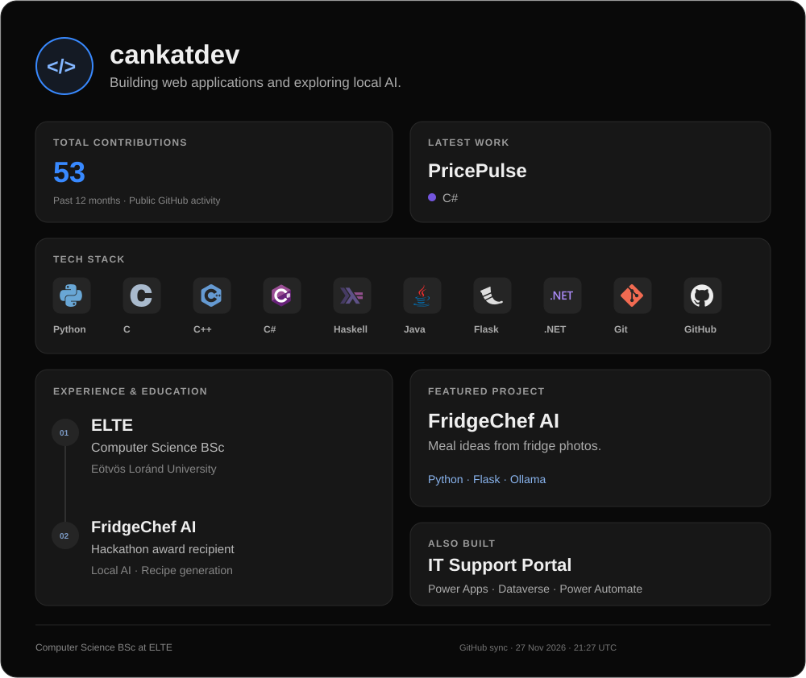

 

<a href="https://github.com/cankatdev/FridgeChef-AI">FridgeChef AI</a> ·
<a href="https://github.com/cankatdev/it-support-portal-power-platform">IT Support Portal</a> ·
<a href="https://github.com/cankatdev/PricePulse">PricePulse</a>

About this profile

The contribution count and latest work refresh automatically every six hours using public GitHub data. Contributions cover the past twelve months. Latest work is selected from the three projects linked above, ordered by the latest push.

The visitor badge starts counting image requests when enabled. It is supplied by [Komarev](https://github.com/antonkomarev/github-profile-views-counter), and is not a count of unique people.

Edit [profile.json](./profile.json) to update the education, technologies and selected projects. The card generator lives in [scripts/update_profile.py](./scripts/update_profile.py).

Technology logos from [Simple Icons](https://github.com/simple-icons/simple-icons) and [Devicon](https://github.com/devicons/devicon).

